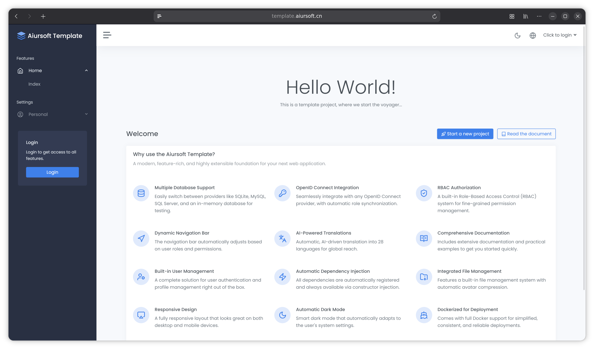
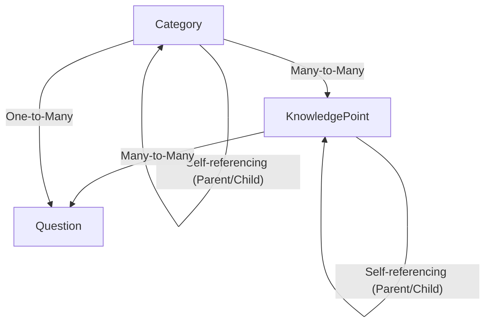
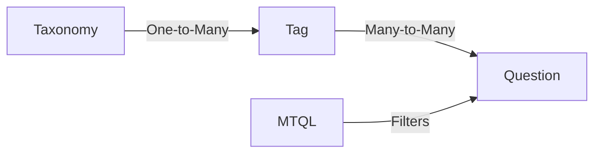
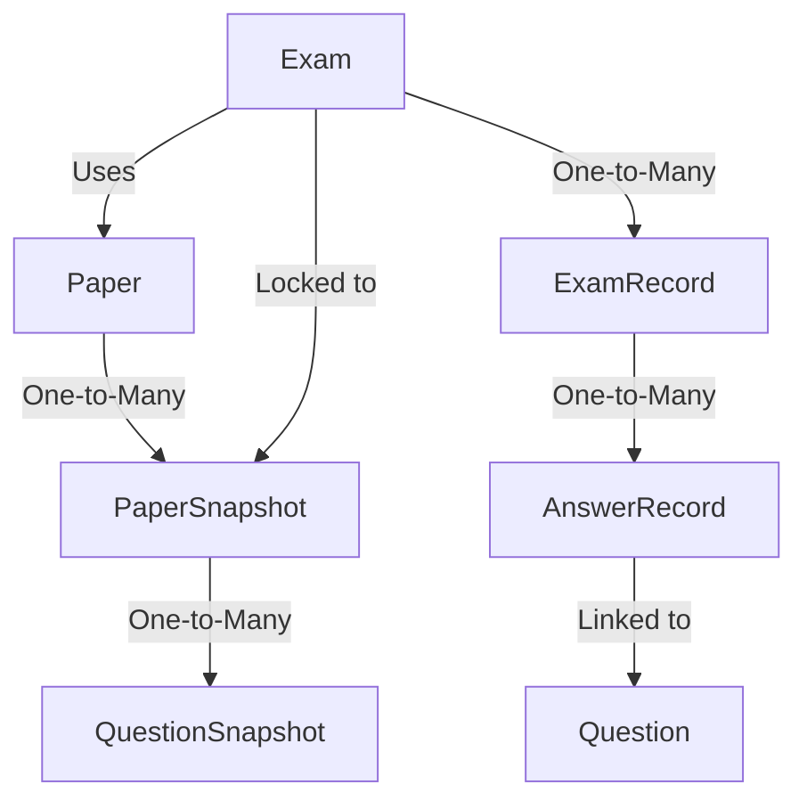

# Aiursoft WeChatExam

<a name="wechatexam"></a>

[](https://github.com/aiursoftweb/weChatExam/blob/master/LICENSE)
[](https://gitlab.aiursoft.com/aiursoft/weChatExam/-/pipelines)
[](https://gitlab.aiursoft.com/aiursoft/weChatExam/-/pipelines)
[](https://s360.aiursoft.com/SupplyChain?tab=projects&project=aiursoft%2Fwechatexam&scope=baseline&ecosystem=all)
[](https://manhours.aiursoft.com/r/github.com/aiursoftweb/weChatExam.html)
[](https://weChatExam.aiursoft.cn)
[](https://hub.docker.com/r/aiursoft/wechatexam)

WeChatExam is an online exam platform with WeChat integration, built on the Aiursoft ecosystem.



Default user name is `admin@default.com` and default password is `Admin@123456!`.

## Overview

### What is WeChatExam?

WeChatExam is an online exam platform with WeChat integration, built on the Aiursoft ecosystem.

## Try

Try a running WeChatExam [here](https://weChatExam.aiursoft.com).

## Install with Docker

Install Docker, then use the image and persistent-volume commands in [Run in Docker](#run-in-docker). This repository does not provide an `install.sh` script.

## Run manually

Requirements about how to run

1. Install [.NET 10 SDK](http://dot.net/) and [Node.js](https://nodejs.org/).
2. Execute `npm install` at `wwwroot` folder to install the dependencies.
3. Execute `dotnet run` to run the app.
4. Use your browser to view [http://localhost:5000](http://localhost:5000).

## Run in Microsoft Visual Studio

1. Open the `.sln` file in the project path.
2. Press `F5` to run the app.

## Run in Docker

First, install Docker [here](https://docs.docker.com/get-docker/).

Then run the following commands in a Linux shell:

```bash
image=aiursoft/weChatExam
appName=weChatExam
sudo docker pull $image
sudo docker run -d --name $appName --restart unless-stopped -p 5000:5000 -v /var/www/$appName:/data $image
```

That will start a web server at `http://localhost:5000` and you can test the app.

The docker image has the following context:

| Properties  | Value                           |
|-------------|---------------------------------|
| Image       | aiursoft/weChatExam               |
| Ports       | 5000                            |
| Binary path | /app                            |
| Data path   | /data                           |
| Config path | /data/appsettings.json          |

## Usage

### Ubuntu deployment notes

<a name="run-in-ubuntu"></a>

The previous Ubuntu installer instructions referenced `install.sh`, which is not present in this repository. Use the Docker commands in [Run in Docker](#run-in-docker) instead of the removed installer URLs.

### Data Structure and MTQL

The project follows a complex data structure to support various exam scenarios. Below are the key components and their relationships.

#### 1. Content Organization (Categories, Knowledge Points, and Questions)

The system organizes content using a hierarchical structure for both Categories and Knowledge Points.



- **Category**: A hierarchical tree to organize questions and knowledge points. A question belongs to one category but can be related to multiple knowledge points.
- **Knowledge Point**: A hierarchical tree representing specific educational units. Questions are linked to knowledge points to track what a question is testing.

#### 2. Tagging System and MTQL (MarkToQueryLanguage)

The system uses a flexible tagging system grouped by Taxonomies.



- **Taxonomy**: Groups tags into different systems (e.g., "Difficulty", "Source", "Year").
- **Tag**: Individual labels applied to questions.
- **MTQL (MarkToQueryLanguage)**: A Domain Specific Language (DSL) used to query questions by tags. It supports boolean logic like `(tag1 || tag2) && not tag3`. This allows for highly flexible question selection when building papers or exams.

#### 3. Paper and Exam System

The system distinguishes between Paper templates and actual Exam instances, using snapshots for content freezing.



- **Paper**: A template for an exam, containing a set of questions.
- **PaperSnapshot**: A frozen version of a Paper. When an exam starts, it uses a snapshot to ensure all students see the same questions even if the Paper template is updated later.
- **QuestionSnapshot**: A frozen version of a Question within a PaperSnapshot.
- **Exam**: An actual instance of an assessment with start/end times.
- **ExamRecord**: A student's attempt at an exam.
- **AnswerRecord**: A student's individual answer to a question in an exam attempt.

## Configuration

The application defaults are defined in [`src/Aiursoft.WeChatExam/appsettings.json`](src/Aiursoft.WeChatExam/appsettings.json). The Docker image initializes `/data/appsettings.json` on its first start and keeps it for later starts; persist `/data`. Override nested values with double-underscore environment variables, such as `Logging__LogLevel__Default`.

```jsonc
{
  "ConnectionStrings": {
    "AllowCache": "True",
    "DbType": "Sqlite",
    "DefaultConnection": "DataSource=app.db;Cache=Shared"
    // sudo docker run -d --name db -e MYSQL_RANDOM_ROOT_PASSWORD=true -e MYSQL_DATABASE=wechatexam -e MYSQL_USER=wechatexam -e MYSQL_PASSWORD=wechatexam_password -p 3306:3306 hub.aiursoft.com/mysql
    //"DbType": "MySql",
    //"DefaultConnection": "Server=localhost;Database=wechatexam;Uid=wechatexam;Pwd=wechatexam_password;"
  },
  "Storage": {
    "Path": "/tmp/data",
    "PublicOrigin": "",
    "RequireDedicatedInlineOrigin": false,
    "AllowArbitraryInlineOnDedicatedOrigin": false,
    "SafeInlineMediaExtensions": ["svg"],
    "SafeInlineSvgSubfolders": ["project-logo"],
    "UploadPolicy": {
      "RequireAuthenticatedUser": false,
      "ReplaceSpacesWithHyphens": false
    }
  },
  "AppSettings": {
    "AuthProvider": "Local", // OIDC or Local
    "WeChatEnabled": true,
    "DefaultRole": "",
    "PersistsSignIn": false,
    "DebugMode": false,
    "DebugMagicKey": "debug-secret-key-change-in-production",
    "OIDC": {
      "Authority": "https://auth.aiursoft.com/application/o/wechatexam",
      "ClientId": "",
      "ClientSecret": "",
      "RolePropertyName": "groups",
      "UsernamePropertyName": "preferred_username",
      "UserDisplayNamePropertyName": "name",
      "EmailPropertyName": "email",
      "UserIdentityPropertyName": "sub"
    },
    "Local": {
      "AllowRegister": true,
      "AllowWeakPassword": true
    },
    "WeChat": {
      "AppId": "your-app-id",
      "AppSecret": "your-app-secret-for-wechat-mini-program",
      "VirtualPayment": {
        "Enabled": false,
        "IosRefundAdviceEnabled": false,
        "Environment": 1,
        "OfferId": "",
        "AppKey": "",
        "SandboxAppKey": "",
        "GoodsSync": { "Enabled": false, "PictureUrl": "" },
        "Products": {}
      },
      "Payment": {
        "Enabled": true,
        "MchId": "your-merchant-id",
        "CertificateSerialNumber": "your-certificate-serial-number",
        "V3SecretKey": "your-v3-secret-key",
        "PrivateKeyFilePath": "/path/to/apiclient_key.pem",
        "PlatformPublicKeyId": "PUB_KEY_ID_11111",
        "PlatformPublicKeyFilePath": "/path/to/pub_key.pem",
        "PaymentNotifyUrl": "https://your-domain.com/api/payment/notify"
      }
    }
  },
  "GlobalSettings": {
    // You can initialize or override global settings here.
    // "Allow_User_Adjust_Nickname": "True",
    // "BrandName": "Aiursoft",
    // "BrandHomeUrl": "https://www.aiursoft.com/",
    // "Icp": "",
    // "ProjectName": "Aiursoft WeChatExam"
  },
  "OpenAI": {
    "Token": "",
    "CompletionApiUrl": "http://127.0.0.1:11434/api/chat",
    "Model": "qwen3.5:27b-q8_0"
  },
  "Logging": {
    "LogLevel": {
      "Default": "Information",
      "Microsoft.AspNetCore": "Warning"
    },
    "Clickhouse": {
      "Enabled": false,
      "ConnectionString": "Host=localhost;Protocol=http;Port=8123;User=default;Password=;Database=AspNetCoreLogs",
      "TableName": "WeChatExamLogs"
    }
  },
  "AllowedHosts": "*"
}
```

### Shared settings

- `ConnectionStrings` selects the database provider and connection. Prepare the external database before choosing MySQL; keep the SQLite file persistent when using SQLite.
- `Storage` configures local application files. Keep the storage directory persistent and use the documented hostname and upload policies for shared downloads.
- `AppSettings` controls authentication and account synchronization. Choose local accounts or configure the OIDC authority, client and `/signin-oidc` callback; use environment variables for credentials.
- Uncommented `GlobalSettings` entries override the database-backed administration settings. Leave entries commented to use the stored values or application defaults.
- `Logging:LogLevel` controls application and framework verbosity. Configure the optional ClickHouse exporter only when its server and credentials are ready.
- `AllowedHosts` is the ASP.NET Core Host-header allowlist, not a CORS setting.

## How to contribute

There are many ways to contribute to the project: logging bugs, submitting pull requests, reporting issues, and creating suggestions.

Even if you with push rights on the repository, you should create a personal fork and create feature branches there when you need them. This keeps the main repository clean and your workflow cruft out of sight.

We're also interested in your feedback on the future of this project. You can submit a suggestion or feature request through the issue tracker. To make this process more effective, we're asking that these include more information to help define them more clearly.

## License

Licensed under the [MIT License](LICENSE).
